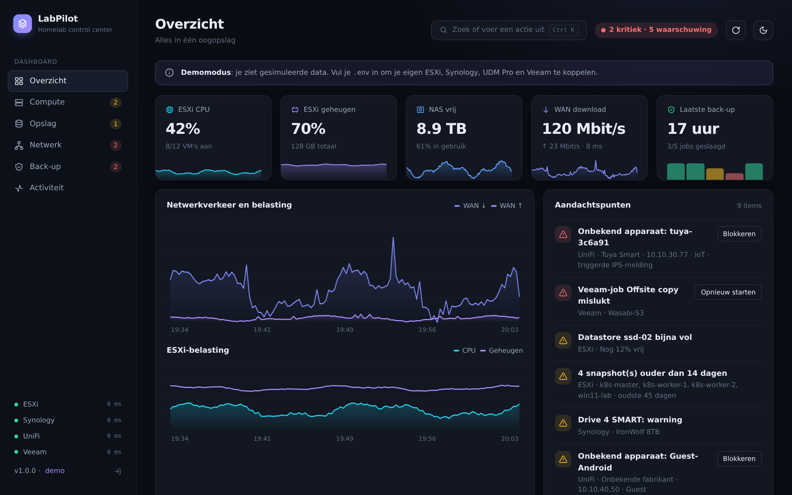
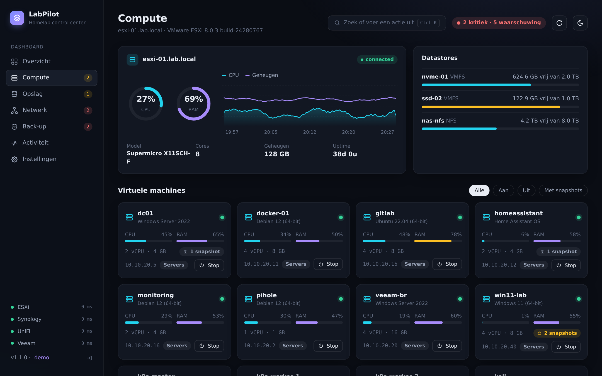
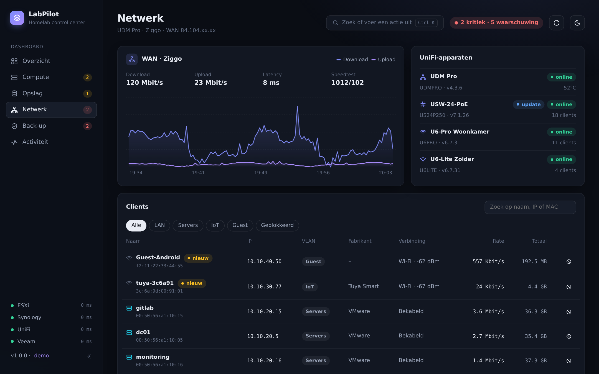
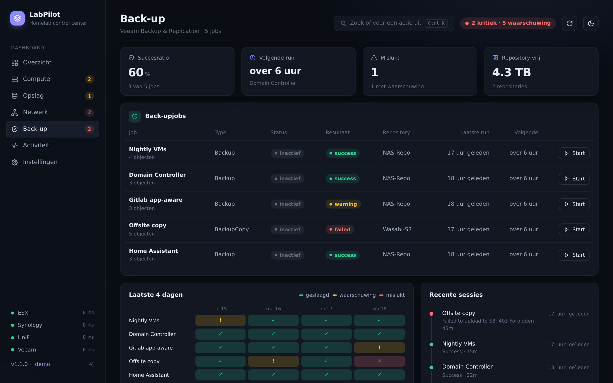

<div align="center">


# LabPilot

**Eén dashboard voor je hele homelab: VMware ESXi, Synology, UniFi en Veeam.**

Live status, slimme aandachtspunten, VM ↔ netwerk-koppeling en acties met één klik. Draait als één lichte Docker-container.



</div>

---

## Wat het doet

| | |
|---|---|
| **Compute (ESXi)** | Host-CPU/RAM met historie, datastores, alle VM's met status, IP, VLAN en snapshots. VM's starten en afsluiten. |
| **Opslag (Synology)** | Volumes, schijven met SMART en temperatuur, UPS-status, Hyper Backup-taken. |
| **Netwerk (UniFi)** | WAN-doorvoer en latency, UniFi-apparaten, alle clients per VLAN, IPS-meldingen. Clients blokkeren en deblokkeren. |
| **Back-up (Veeam)** | Jobs met resultaat, een overzicht van de laatste 4 dagen, sessies, repository-ruimte. Jobs starten en stoppen. |
| **Correlatie** | VM's worden via het MAC-adres gekoppeld aan UniFi-clients: je ziet per VM het VLAN en live verkeer. Een onbekend apparaat dat óók een IPS-melding triggert wordt kritiek. |
| **Aandachtspunten** | Oude snapshots, volle datastores of volumes, slechte schijven, mislukte back-ups, nieuwe onbekende apparaten, UPS op batterij, firmware-updates. |
| **Command palette** | `Ctrl K` (of `/`) om direct een VM, client, job of actie te vinden. |
| **Live** | Updates via Server-Sent Events, geen refresh nodig. Donker en licht thema. |

<table>
<tr><td></td><td></td></tr>
<tr><td></td><td></td></tr>
<tr><td></td><td></td></tr>
</table>

## Snel starten

### Portainer

1. **Stacks › Add stack**, geef hem een naam (bijv. `labpilot`)
2. Plak de inhoud van [`docker-compose.yml`](docker-compose.yml) in de web-editor
3. **Deploy the stack**
4. Open **http://&lt;host&gt;:38471** en ga naar **Instellingen**

### Docker Compose

```bash
mkdir labpilot && cd labpilot
curl -LO https://raw.githubusercontent.com/RichrdJ/labpilot/main/docker-compose.yml
docker compose up -d
```

### Synology Container Manager

**Container Manager › Project › Aanmaken**, kies een map en plak de inhoud van `docker-compose.yml`.

Zonder koppelingen start LabPilot in **demomodus** met realistische nepdata.

## Configuratie

Alles stel je in via de webinterface onder **Instellingen**:

- per koppeling (ESXi, Synology, UniFi, Veeam) het adres, de gebruiker en het wachtwoord of de API-key, met een knop **Verbinding testen**
- een koppeling tijdelijk uitzetten met de schakelaar
- algemeen: naam van het dashboard, ververs-interval, acties aan/uit, drempels voor oude snapshots en volle schijven, en een **inlogwachtwoord** voor het dashboard

De instellingen staan in het volume `labpilot-data` (`/data/settings.json`, alleen leesbaar voor de container). Wachtwoorden worden nooit teruggestuurd naar de browser. Stel een inlogwachtwoord in als anderen op je netwerk bij het dashboard kunnen.

De poort wijzig je in `docker-compose.yml` (`"38471:8080"` → `"<jouw-poort>:8080"`).

<details>
<summary>Omgevingsvariabelen (optioneel)</summary>

Bij de allereerste start, zolang er nog niets via de webinterface is opgeslagen, leest LabPilot de variabelen uit [`.env.example`](.env.example) als startwaarden. Daarna gelden alleen de instellingen uit de webinterface.

</details>

### Accounts met minimale rechten

- **ESXi:** een aparte lokale gebruiker met de rol *Read-only*. Voor acties: een eigen rol met `VirtualMachine.Interact.PowerOn/PowerOff`.
- **Synology:** een aparte gebruiker. De storage-API vereist helaas lidmaatschap van *administrators*; schakel 2FA uit voor dit account en beperk de app-rechten.
- **UniFi:** een *lokale* admin met de rol *View only* (of *Site Admin* voor blokkeren), of een API-key.
- **Veeam:** een account met de rol *Veeam Backup Viewer* (of *Backup Operator* voor het starten van jobs).

## Veiligheid

- Draait als non-root met een read-only filesystem; alleen `/data` is schrijfbaar.
- Acties staan standaard **uit**; destructieve acties vragen een tweede klik.
- Zet LabPilot achter je reverse proxy (bijv. Nginx Proxy Manager of Traefik) met HTTPS, en stel een inlogwachtwoord in via Instellingen.
- Zet **geen** poort open naar internet; gebruik de VPN van je UDM (WireGuard/Teleport).

## API

De backend is een FastAPI-app met documentatie op `/api/docs`.

| Endpoint | |
|---|---|
| `GET /api/state` | Volledige snapshot (alle bronnen, inzichten, historie) |
| `GET /api/stream` | Server-Sent Events met elke nieuwe snapshot |
| `POST /api/actions` | `{"source": "esxi", "kind": "power_on", "target": "vm-123"}` |
| `POST /api/refresh` | Direct opnieuw meten |
| `GET/PUT /api/settings` | Instellingen lezen en opslaan (wachtwoorden gemaskeerd) |
| `POST /api/settings/test` | Verbinding van één koppeling testen |
| `GET /healthz` | Healthcheck |

## Ontwikkelen

```bash
pip install -r requirements-dev.txt
DATA_DIR=./data uvicorn app.main:app --reload --port 8080
pytest && ruff check app tests
```

De frontend is vanilla HTML/CSS/JS in `app/static`, zonder buildstap.

## Releases

Een tag `vX.Y.Z` pushen start de workflow `.github/workflows/release.yml`:

1. tests en lint
2. multi-arch image (`amd64` + `arm64`) naar `ghcr.io/richrdj/labpilot` met de tags `X.Y.Z`, `X.Y`, `X` en `latest`
3. een GitHub Release met changelog en een zip met `docker-compose.yml` en `.env.example`

```bash
git tag v1.1.0 && git push origin v1.1.0
```

## Licentie

MIT
