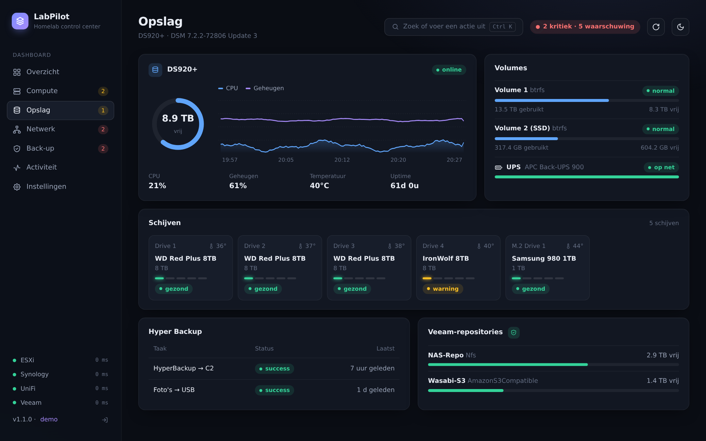
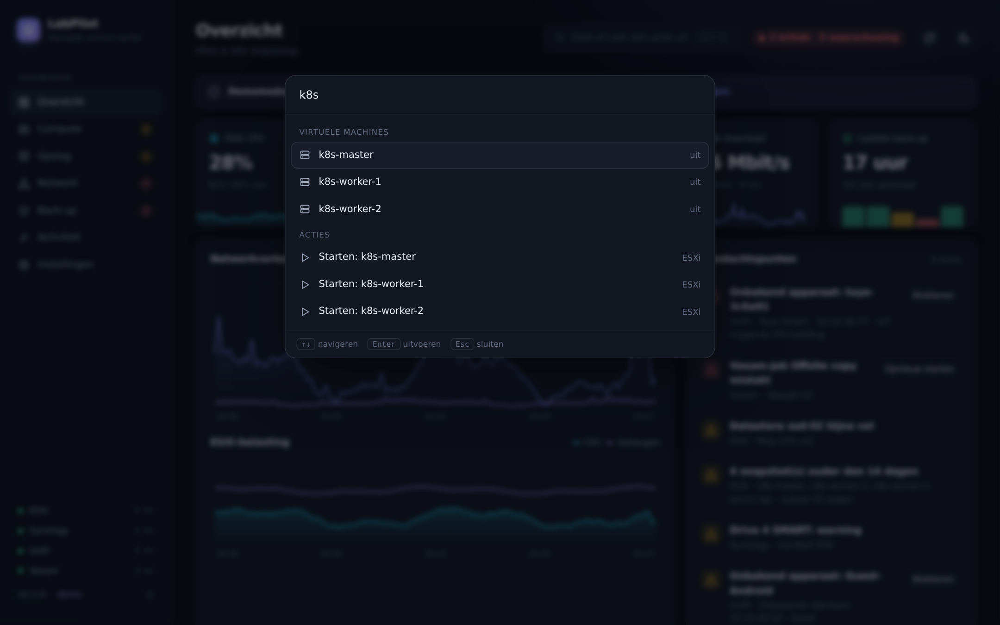
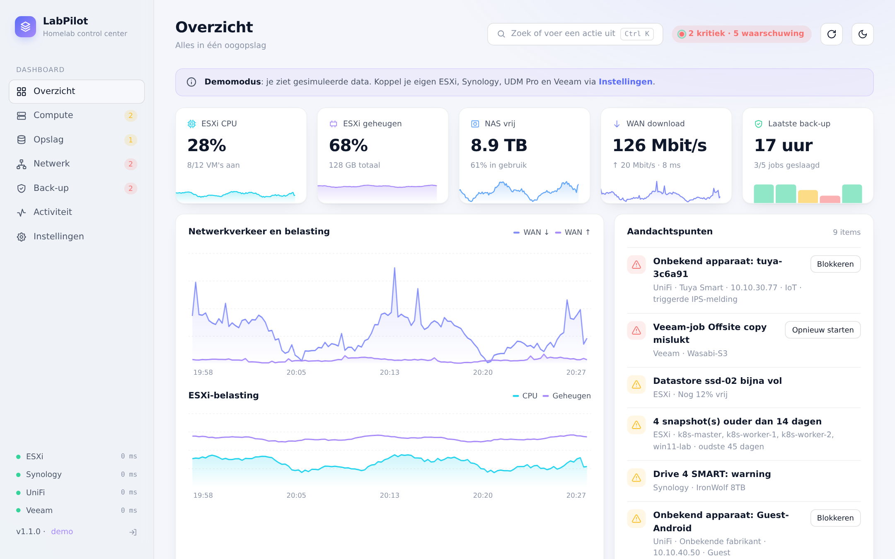

<div align="center">


# LabPilot

**Eén dashboard voor je hele homelab: VMware ESXi, Synology, UniFi en Veeam.**

Live status, slimme aandachtspunten, VM ↔ netwerk-koppeling en acties met één klik. Draait als één lichte Docker-container.


</div>

---

## Wat het doet

| | |
|---|---|
| **Compute (ESXi)** | Host-CPU/RAM met historie, datastores, alle VM's met status, IP, VLAN en snapshots. VM's starten en afsluiten. |
| **Opslag (Synology)** | Volumes, schijven met SMART en temperatuur, UPS-status, Hyper Backup-taken. |
| **Netwerk (UniFi)** | WAN-doorvoer en latency, UniFi-apparaten, alle clients per VLAN, IPS-meldingen. Clients blokkeren en deblokkeren. |
| **Back-up (Veeam)** | Jobs met resultaat, een overzicht van de laatste 4 dagen, sessies, repository-ruimte. Jobs starten en stoppen. |
| **Correlatie** | VM's worden via het MAC-adres gekoppeld aan UniFi-clients: je ziet per VM het VLAN en live verkeer. Een onbekend apparaat dat óók een IPS-melding triggert wordt kritiek. |
| **Aandachtspunten** | Oude snapshots, volle datastores of volumes, slechte schijven, mislukte back-ups, nieuwe onbekende apparaten, UPS op batterij, firmware-updates. |
| **Command palette** | `Ctrl K` (of `/`) om direct een VM, client, job of actie te vinden. |
| **Live** | Updates via Server-Sent Events, geen refresh nodig. Donker en licht thema. |

<table>
<tr><td></td><td></td></tr>
<tr><td></td><td></td></tr>
<tr><td></td><td></td></tr>
</table>

## Snel starten

```bash
mkdir labpilot && cd labpilot
curl -LO https://raw.githubusercontent.com/RichrdJ/labpilot/main/docker-compose.yml
curl -L https://raw.githubusercontent.com/RichrdJ/labpilot/main/.env.example -o .env
# vul .env in (of laat leeg voor de demo)
docker compose up -d
```

Open daarna **http://&lt;host&gt;:38471**. Zonder configuratie start LabPilot in **demomodus** met realistische nepdata.

Je kunt ook de zip van de [laatste release](../../releases/latest) downloaden: daar zitten `docker-compose.yml` en `.env.example` al in.

### Synology Container Manager

1. **Container Manager › Project › Aanmaken**
2. Kies een map (bijv. `/docker/labpilot`) en plak de inhoud van `docker-compose.yml`
3. Zet een `.env` in dezelfde map (via File Station)
4. Bouwen en starten. Het image komt van `ghcr.io/richrdj/labpilot`.

## Configuratie

Alles gaat via omgevingsvariabelen; zie [`.env.example`](.env.example). Bronnen zonder instellingen worden overgeslagen.

| Variabele | Standaard | Omschrijving |
|---|---|---|
| `POLL_INTERVAL` | `15` | Seconden tussen metingen |
| `ACTIONS_ENABLED` | `false` | Acties toestaan (VM aan/uit, client blokkeren, Veeam-job starten) |
| `LABPILOT_PASSWORD` | – | Wachtwoord voor de inlogpagina |
| `LABPILOT_SECRET` | random | Sleutel voor sessiecookies (zet vast, anders log je uit bij een herstart) |
| `SNAPSHOT_MAX_AGE_DAYS` | `14` | Vanaf hoeveel dagen een snapshot "oud" is |
| `LOW_SPACE_PCT` | `15` | Drempel voor "bijna vol" |
| `ESXI_*` | – | `HOST`, `USER`, `PASSWORD`, `PORT`, `VERIFY_SSL` (werkt ook met vCenter) |
| `SYNOLOGY_*` | – | `URL` (bijv. `https://nas:5001`), `USER`, `PASSWORD`, `VERIFY_SSL` |
| `UNIFI_*` | – | `URL`, `USER` + `PASSWORD` **of** `API_KEY`, `SITE`, `VERIFY_SSL` |
| `VEEAM_*` | – | `URL` (poort 9419), `USER`, `PASSWORD`, `API_VERSION`, `VERIFY_SSL` |

### Accounts met minimale rechten

- **ESXi:** een aparte lokale gebruiker met de rol *Read-only*. Voor acties: een eigen rol met `VirtualMachine.Interact.PowerOn/PowerOff`.
- **Synology:** een aparte gebruiker. De storage-API vereist helaas lidmaatschap van *administrators*; schakel 2FA uit voor dit account en beperk de app-rechten.
- **UniFi:** een *lokale* admin met de rol *View only* (of *Site Admin* voor blokkeren), of een API-key.
- **Veeam:** een account met de rol *Veeam Backup Viewer* (of *Backup Operator* voor het starten van jobs).

## Veiligheid

- Draait als non-root met een read-only filesystem.
- Acties staan standaard **uit**; destructieve acties vragen een tweede klik.
- Zet LabPilot achter je reverse proxy (bijv. Nginx Proxy Manager of Traefik) met HTTPS, en/of gebruik `LABPILOT_PASSWORD`.
- Zet **geen** poort open naar internet; gebruik de VPN van je UDM (WireGuard/Teleport).

## API

De backend is een FastAPI-app met documentatie op `/api/docs`.

| Endpoint | |
|---|---|
| `GET /api/state` | Volledige snapshot (alle bronnen, inzichten, historie) |
| `GET /api/stream` | Server-Sent Events met elke nieuwe snapshot |
| `POST /api/actions` | `{"source": "esxi", "kind": "power_on", "target": "vm-123"}` |
| `POST /api/refresh` | Direct opnieuw meten |
| `GET /healthz` | Healthcheck |

## Ontwikkelen

```bash
pip install -r requirements-dev.txt
DEMO_MODE=true uvicorn app.main:app --reload --port 8080
pytest && ruff check app tests
```

De frontend is vanilla HTML/CSS/JS in `app/static`, zonder buildstap.

## Releases

Een tag `vX.Y.Z` pushen start de workflow `.github/workflows/release.yml`:

1. tests en lint
2. multi-arch image (`amd64` + `arm64`) naar `ghcr.io/richrdj/labpilot` met de tags `X.Y.Z`, `X.Y`, `X` en `latest`
3. een GitHub Release met changelog en een zip met `docker-compose.yml` en `.env.example`

```bash
git tag v1.1.0 && git push origin v1.1.0
```

## Licentie

MIT
